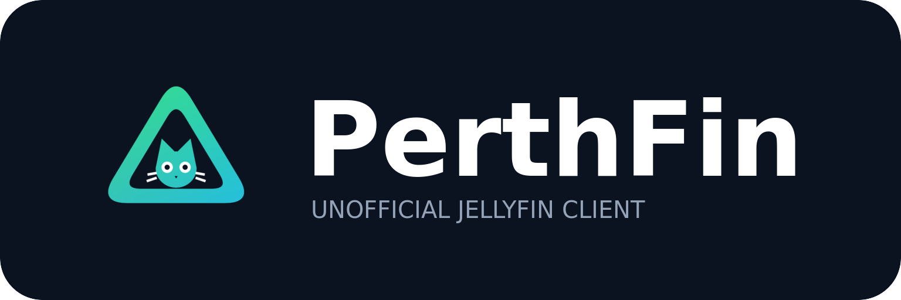
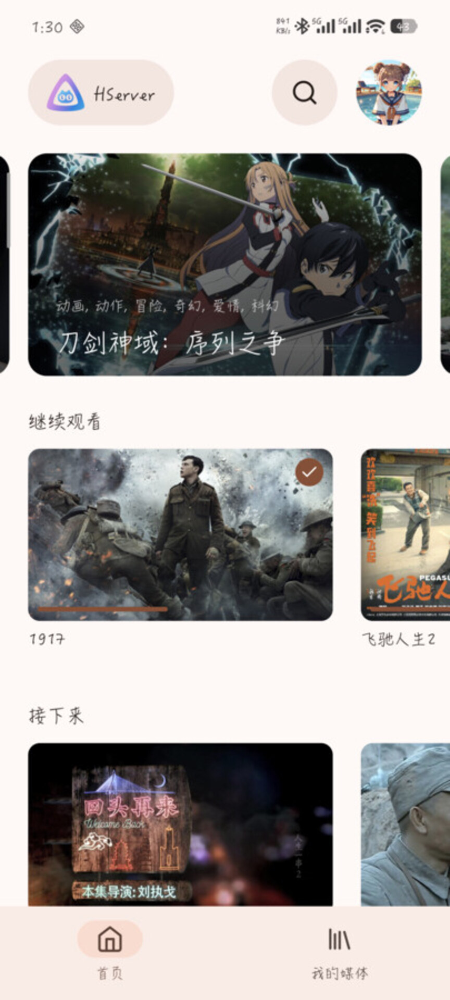
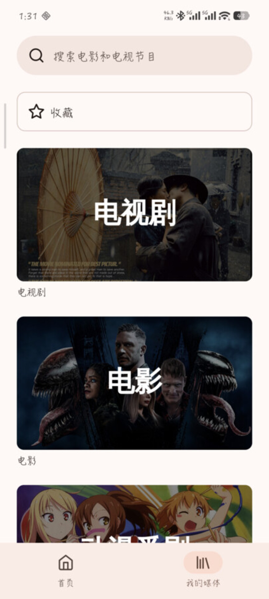
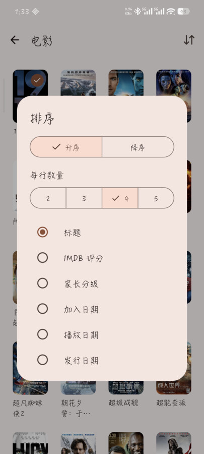
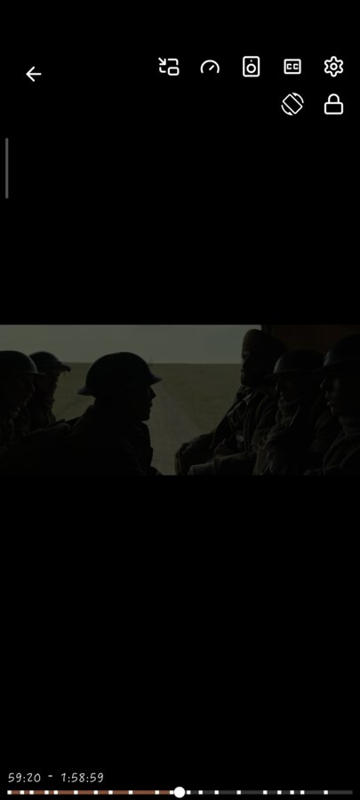
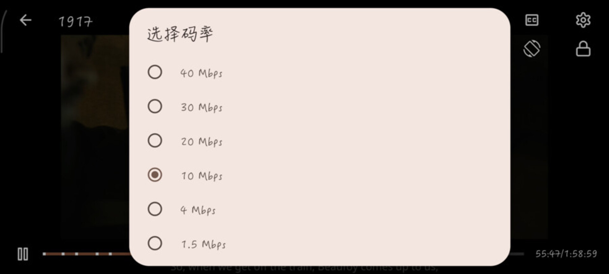
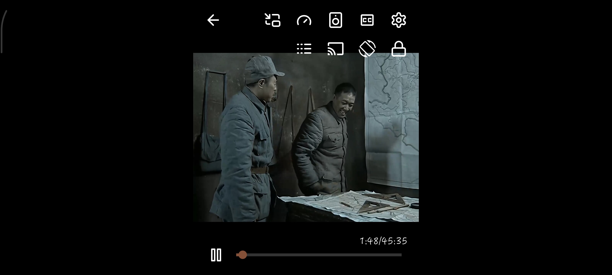

# PerthFin

[简体中文](README.md) | English

PerthFin is an independent native Android client for [Jellyfin](https://jellyfin.org),
built on top of the open-source [Findroid](https://github.com/jarnedemeulemeester/findroid)
project.

It is an independent derivative, **not a fork of the upstream repository**, and is
**not affiliated with, endorsed by, or sponsored by** the Jellyfin project or the
[Findroid](https://github.com/jarnedemeulemeester/findroid) author. "Jellyfin" is used
descriptively only.

<p align="center">
  <a href="https://github.com/MeowPerth/PerthFin/releases"></a>
  <a href="https://github.com/MeowPerth/PerthFin/stargazers"></a>
  <a href="https://github.com/MeowPerth/PerthFin/issues"></a>
  <a href="https://github.com/MeowPerth/PerthFin/pulls"></a>
  <a href="https://github.com/MeowPerth/PerthFin/releases"></a>
  <a href="LICENSE"></a>
</p>

- Current version: **1.0.0**
- Package: `com.wuhaohu.perthfin`
- License: GPLv3
- Base: [Findroid](https://github.com/jarnedemeulemeester/findroid) 1.2.0 (commit [`3a06420`](https://github.com/jarnedemeulemeester/findroid/commit/3a06420))

## Screenshots

### Phone UI (portrait)

| Home | Library (3 per row) |
|:---:|:---:|
|  |  |
| **Items per row** | **Portrait playback** |
|  |  |

### Landscape and quality

| Quality / bitrate | Landscape playback |
|:---:|:---:|
|  |  |

## Features

### Library and discovery

- Native Android UI built with Kotlin and Jetpack Compose
- Movies, series, seasons and episodes
- Collections / box sets
- Multiple Jellyfin libraries
- Home sections: suggestions, continue watching, next up and latest
- Search across movies and series
- Favorites for movies, series and episodes
- Item details: overview, cast and crew, media information, chapters and trickplay
- Configurable number of items per row in libraries, search results, favorites and collections

### Playback

- Direct play by default
- Server-side transcoding to HLS (H.264 video / AAC audio)
- Quality presets: original, 30, 20, 10, 4 and 1.5 Mbps
- In-player quality switching, resuming at the current position
- ExoPlayer (default) and libmpv backends
- Picture-in-picture
- Playback speed selection
- Chapter timeline markers and chapter skip gestures
- Intro / outro media segment skipping (button and auto-skip)
- Trickplay previews while seeking
- Portrait and landscape playback
- Quick rotation toggle in the player
- "Default to landscape" setting; when disabled, the last playback orientation is reused
- Volume, brightness, seek and zoom gestures
- Resumes playback from the last reported position

### Audio and subtitles

- Audio track selection
- Subtitle track selection, including "none"
- Audio and subtitle choices are remembered per item
- Falls back to the preferred audio / subtitle language when no per-item choice exists
- Selected subtitles are burned into the video stream when transcoding
- External and embedded subtitles in direct play
- Subtitle appearance follows the system caption settings

### Accounts, servers and UI

- Multiple servers and multiple users per server
- Jellyfin server discovery
- Password login and Quick Connect
- User avatars in the home header and user selection screen
- App language selection
- Light, dark, AMOLED and dynamic-color themes
- Configurable player backend and gesture behavior
- Preferred audio / subtitle language settings

### Not included in 1.0.0

- Downloads and offline playback (removed; PerthFin is online-only)
- Android TV support (removed)
- Chromecast / Google Cast
- DLNA casting (planned for the next release)

## Codec support

Codec support depends on the Android device and the selected player backend.

### ExoPlayer (default)

- Video: H.263, H.264, H.265, VP8, VP9, AV1
- Audio: Vorbis, Opus, FLAC, ALAC, PCM, MP3, AAC, AC-3, E-AC-3, DTS, DTS-HD, TrueHD
  (partly provided by the FFmpeg extension)
- Subtitles: SRT, VTT, SSA/ASS, PGSSUB (SSA/ASS styling support is limited)

### libmpv

- Containers: MKV, MOV, MP4, AVI
- Video: H.264, H.265, H.266, VP8, VP9, AV1
- Audio: Opus, FLAC, MP3, AAC, AC-3, E-AC-3, TrueHD, DTS, DTS-HD
- Subtitles: SRT, VTT, SSA/ASS, DVDSUB
- Software decoding can be forced when hardware decoding has issues

### Transcoding

When a non-original quality is selected, PerthFin asks the server for an HLS stream
using H.264 video and AAC audio. The selected audio and subtitle indices are passed
to the server; selected subtitles are burned into the stream.

## Requirements

- Jellyfin Server 12.0 or newer
- Android 10 (API 29) or newer
- A phone or tablet; Android TV is not supported

## Install

Download the APK for your device ABI from GitHub Releases:

- `perthfin-v1.0.0-libre-arm64-v8a.apk` — most modern phones
- `perthfin-v1.0.0-libre-armeabi-v7a.apk` — older 32-bit devices
- `perthfin-v1.0.0-libre-x86_64.apk` / `x86` — emulators and x86 devices

The APKs are signed release builds and can be installed directly. PerthFin is not
currently distributed through Google Play.

## Building

Requirements: JDK 17, Android SDK platform 37 and build-tools 37.0.0.

```bash
export JAVA_HOME=/path/to/jdk-17
export ANDROID_HOME=/path/to/android-sdk

./gradlew :app:phone:assembleDebug
```

Debug APKs are written to `app/phone/build/outputs/apk/libre/debug/`.

For a release build:

```bash
./gradlew :app:phone:assembleRelease
```

Release APKs are written to `app/phone/build/outputs/apk/libre/release/`.
Configure your own signing key before distributing a release build.

## Versioning and roadmap

`1.0.0` is the first public PerthFin release. The next release is planned to add
DLNA casting.

## License and attribution

PerthFin is licensed under the GNU General Public License v3.0. See
[LICENSE](LICENSE) and [NOTICE](NOTICE).

The original [Findroid](https://github.com/jarnedemeulemeester/findroid) project is
Copyright (C) Jarne Demeulemeester and contributors. PerthFin modifications are
Copyright (C) 2026 MeowPerth.

The upstream [Findroid](https://github.com/jarnedemeulemeester/findroid) project is
not responsible for this repository or its releases.
