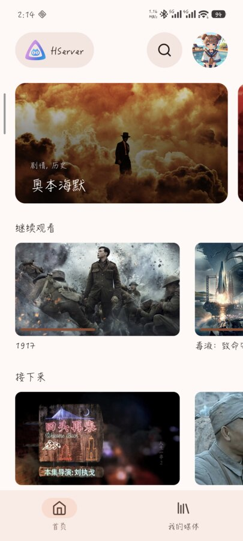
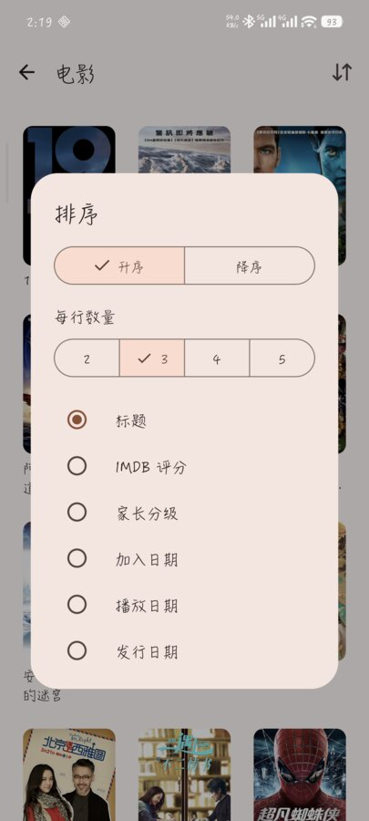
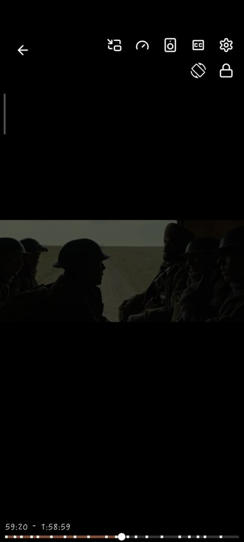

# PerthFin

[简体中文](README.md) | [English](README.en.md)

PerthFin 是一个独立的原生 Android [Jellyfin](https://jellyfin.org) 客户端，基于开源项目
[Findroid](https://github.com/jarnedemeulemeester/findroid) 二次开发。

本项目是独立衍生版本，**不是上游仓库的 fork**，与 Jellyfin 项目及
[Findroid](https://github.com/jarnedemeulemeester/findroid) 作者无隶属、赞助或背书关系。
“Jellyfin”仅作描述性使用。

<p align="center">
  <a href="https://github.com/MeowPerth/PerthFin/releases"></a>
  <a href="https://github.com/MeowPerth/PerthFin/stargazers"></a>
  <a href="https://github.com/MeowPerth/PerthFin/issues"></a>
  <a href="https://github.com/MeowPerth/PerthFin/pulls"></a>
  <a href="https://github.com/MeowPerth/PerthFin/releases"></a>
  <a href="LICENSE"></a>
</p>

- 当前版本：**1.0.0**
- 包名：`com.wuhaohu.perthfin`
- 许可证：GPLv3
- 上游基线：[Findroid](https://github.com/jarnedemeulemeester/findroid) 1.2.0（commit [`3a06420`](https://github.com/jarnedemeulemeester/findroid/commit/3a06420)）

## 截图

| 首页 | 媒体库（每行 3 个） |
|:---:|:---:|
|  |  |
| **每行数量设置** | **画质 / 码率调整** |
|  |  |
| **竖屏播放** | **横屏播放** |
|  |  |

## 功能

### 媒体库与发现

- Kotlin + Jetpack Compose 原生 Android 界面
- 电影、剧集、季、单集
- 合集 / BoxSet
- 多 Jellyfin 媒体库
- 首页：推荐、继续观看、接下来、最新
- 搜索电影和剧集
- 收藏电影、剧集和单集
- 详情页：简介、演职人员、媒体信息、章节、Trickplay
- 媒体库、搜索结果、收藏和合集支持自定义每行数量

### 播放

- 默认直连播放
- 服务端转码为 HLS（H.264 视频 / AAC 音频）
- 画质档位：原画、30、20、10、4、1.5 Mbps
- 播放中切换画质，并从当前位置继续
- ExoPlayer（默认）和 libmpv 两种播放后端
- 画中画
- 播放速度选择
- 章节时间轴标记与章节跳转手势
- 片头 / 片尾跳过（按钮和自动跳过）
- 拖动进度时显示 Trickplay 预览
- 横屏和竖屏播放
- 播放器内快速切换横竖屏
- 「默认横屏模式」开关；关闭后沿用上一次播放方向
- 音量、亮度、快进/快退和缩放手势
- 自动从上次播放位置继续

### 音轨与字幕

- 音轨选择
- 字幕选择，包括「无」
- 每部影片分别记忆音轨和字幕选择
- 没有手动选择时，按首选音轨 / 字幕语言匹配
- 转码时把选中的字幕烧录进视频码流
- 直连时支持内嵌和外挂字幕
- 字幕样式跟随系统字幕设置

### 账号、服务器与界面

- 多服务器、多用户
- Jellyfin 服务器发现
- 密码登录和 Quick Connect
- 首页和用户选择页显示用户头像
- 应用语言切换
- 浅色、深色、AMOLED 和动态颜色主题
- 可配置播放器后端和手势行为
- 首选音轨 / 字幕语言设置

### 1.0.0 不包含

- 下载与离线播放（已移除，PerthFin 为纯在线客户端）
- Android TV（已移除）
- Chromecast / Google Cast
- DLNA 投屏（计划下个版本支持）

## 编解码支持

实际支持取决于 Android 设备和播放后端。

### ExoPlayer（默认）

- 视频：H.263、H.264、H.265、VP8、VP9、AV1
- 音频：Vorbis、Opus、FLAC、ALAC、PCM、MP3、AAC、AC-3、E-AC-3、DTS、DTS-HD、TrueHD（部分由 FFmpeg 扩展提供）
- 字幕：SRT、VTT、SSA/ASS、PGSSUB（SSA/ASS 样式支持有限）

### libmpv

- 容器：MKV、MOV、MP4、AVI
- 视频：H.264、H.265、H.266、VP8、VP9、AV1
- 音频：Opus、FLAC、MP3、AAC、AC-3、E-AC-3、TrueHD、DTS、DTS-HD
- 字幕：SRT、VTT、SSA/ASS、DVDSUB
- 硬件解码异常时可以强制软件解码

### 转码

选择非「原画」画质时，PerthFin 会向服务端请求 H.264 + AAC 的 HLS 流，
并把选中的音轨、字幕索引传给服务端；选中的字幕会烧录进码流。

## 环境要求

- Jellyfin Server 12.0 或更高
- Android 10（API 29）或更高
- 手机或平板；不支持 Android TV

## 安装

从 GitHub Releases 下载对应 ABI 的 APK：

- `perthfin-v1.0.0-libre-arm64-v8a.apk`：大多数现代手机
- `perthfin-v1.0.0-libre-armeabi-v7a.apk`：较老的 32 位设备
- `perthfin-v1.0.0-libre-x86_64.apk` / `x86`：模拟器和 x86 设备

APK 使用 release key 签名，直接安装即可；当前不通过 Google Play 分发。

## 构建

需要 JDK 17、Android SDK platform 37 和 build-tools 37.0.0。

```bash
export JAVA_HOME=/path/to/jdk-17
export ANDROID_HOME=/path/to/android-sdk

./gradlew :app:phone:assembleDebug
```

Debug APK 输出到 `app/phone/build/outputs/apk/libre/debug/`。

Release 构建：

```bash
./gradlew :app:phone:assembleRelease
```

Release APK 输出到 `app/phone/build/outputs/apk/libre/release/`。
正式分发前请配置自己的签名密钥。

## 版本与路线图

`1.0.0` 是 PerthFin 的首个公开版本。下个版本计划加入 DLNA 投屏。

## 许可证与署名

PerthFin 使用 GNU General Public License v3.0 许可，详见 [LICENSE](LICENSE) 和
[NOTICE](NOTICE)。

原 [Findroid](https://github.com/jarnedemeulemeester/findroid) 项目版权归
Jarne Demeulemeester 及贡献者所有。PerthFin 的修改版权归 MeowPerth 所有。

上游 [Findroid](https://github.com/jarnedemeulemeester/findroid) 项目不对本仓库及其发布负责。
