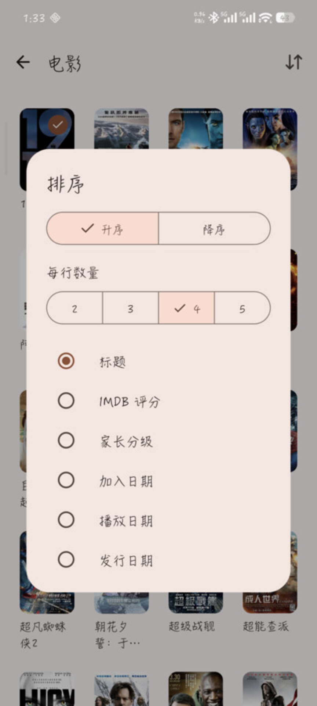
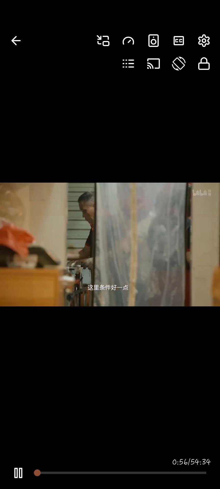
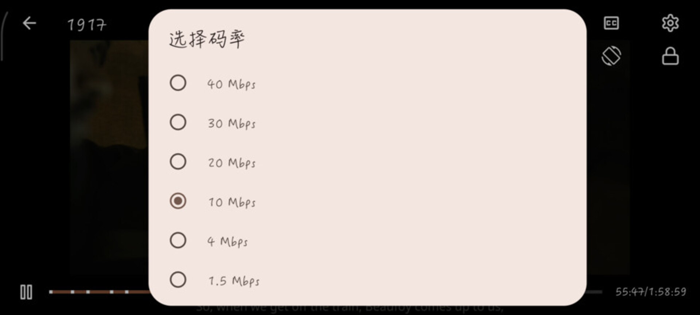
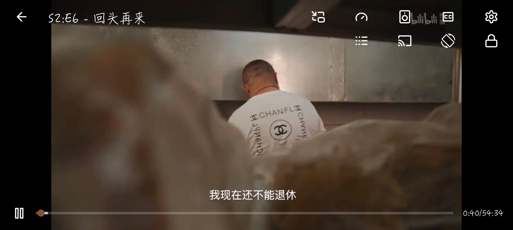
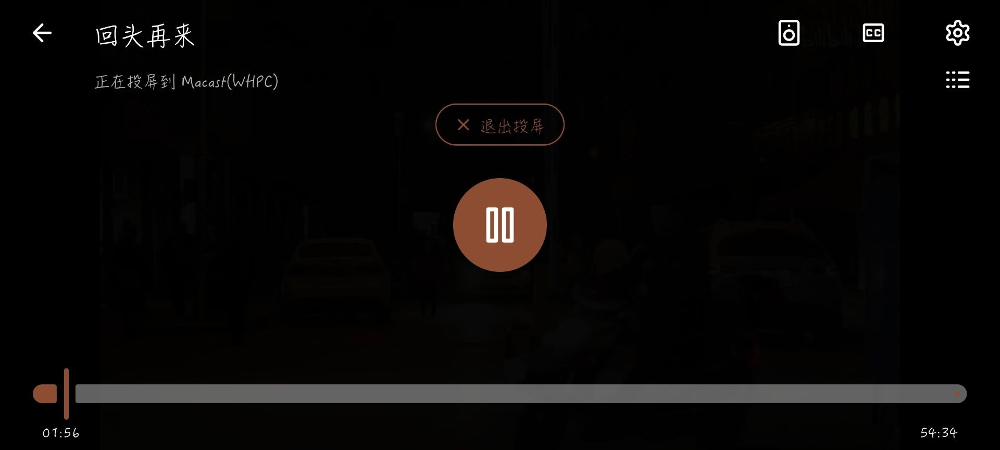
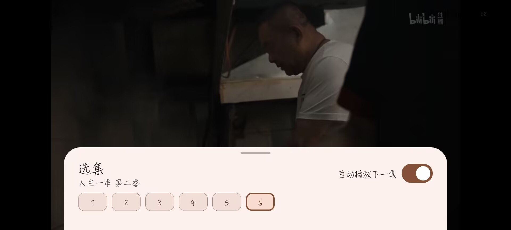

# PerthFin

[简体中文](README.md) | [English](README.en.md)

PerthFin 是一个独立的原生 Android [Jellyfin](https://jellyfin.org) 客户端，基于开源项目
[Findroid](https://github.com/jarnedemeulemeester/findroid) 二次开发。

本项目是独立衍生版本，**不是上游仓库的 fork**，与 Jellyfin 项目及
[Findroid](https://github.com/jarnedemeulemeester/findroid) 作者无隶属、赞助或背书关系。
“Jellyfin”仅作描述性使用。

<p align="center">
  <a href="https://github.com/MeowPerth/PerthFin/releases"></a>
  <a href="https://github.com/MeowPerth/PerthFin/stargazers"></a>
  <a href="https://github.com/MeowPerth/PerthFin/issues"></a>
  <a href="https://github.com/MeowPerth/PerthFin/pulls"></a>
  <a href="https://github.com/MeowPerth/PerthFin/releases"></a>
  <a href="LICENSE"></a>
</p>

- 当前版本：**1.1.2**
- 包名：`com.wuhaohu.perthfin`
- 许可证：GPLv3
- 上游基线：[Findroid](https://github.com/jarnedemeulemeester/findroid) 1.2.0（commit [`3a06420`](https://github.com/jarnedemeulemeester/findroid/commit/3a06420)）

> 仓库的 Contributors 统计包含 [Findroid](https://github.com/jarnedemeulemeester/findroid) 上游历史作者；PerthFin 的修改由 MeowPerth 维护。

## 截图

### 手机界面（竖屏）

| 首页 | 媒体库（每行 3 个） | 每行数量设置 | 竖屏播放 |
|:---:|:---:|:---:|:---:|
|  |  |  |  |

### 横屏、码率、投屏与选集

| 码率调整 | 横屏播放 | 投屏控制 | 选集与自动下一集 |
|:---:|:---:|:---:|:---:|
|  |  |  |  |

## 功能

### 媒体库与发现

- Kotlin + Jetpack Compose 原生 Android 界面
- 电影、剧集、季、单集
- 合集 / BoxSet
- 多 Jellyfin 媒体库
- 首页：推荐、继续观看、接下来、最新
- 搜索电影和剧集
- 收藏电影、剧集和单集
- 详情页：简介、演职人员、媒体信息、章节、Trickplay
- 媒体库、搜索结果、收藏和合集支持自定义每行数量

### 播放

- 按码率与格式自动直连或 HLS 转码；码率档位 40/30/20/10/4/1.5 Mbps
- 支持 ExoPlayer / libmpv、画中画、播放速度、章节与片头片尾跳过、Trickplay
- 剧集选集：本地播放器和投屏界面都能打开当前季选集，按集数方块选择，当前集高亮
- 「自动播放下一集」开关：位于选集面板顶部，并与「设置 → 播放器」同步；关闭后不会自动续播
- 选集按钮只在剧集内容中显示，电影等单视频不会出现
- 横竖屏播放、快速旋转和「默认横屏模式」
- 底栏：暂停/播放在左，进度条居中，时间在右；竖屏时间位于进度条右上方
- 暂停时中央显示播放按钮，播放时自动隐藏
- 双击区域按 25%/50%/25% 划分：后退 5 秒、暂停/继续、前进 15 秒
- 支持音量、亮度、进度和缩放手势，音量条实时同步手机媒体音量
- 自动从上次播放位置继续

### DLNA 投屏

- 自动发现局域网内的 UPnP MediaRenderer，选择电视后推送当前视频
- 投屏沿用当前码率、音轨和字幕；统一转码为 H.264 + AAC 2ch，字幕烧录
- 支持暂停/继续、拖动进度、退出投屏和重新推送
- 投屏界面支持当前季选集，可直接切换剧集并重新推送
- 投屏控制界面与播放器统一，异常时显示警告图标和状态
- 离开播放器后电视继续播放；设置位于「网络 → DLNA 投屏」

### 音轨与字幕

- 音轨选择
- 字幕选择，包括「无」
- 每部影片分别记忆音轨和字幕选择
- 没有手动选择时，按首选音轨 / 字幕语言匹配
- 转码时把选中的字幕烧录进视频码流
- 直连时支持内嵌和外挂字幕
- 字幕样式跟随系统字幕设置

### 账号、服务器与界面

- 多服务器、多用户
- Jellyfin 服务器发现
- 密码登录和 Quick Connect
- 首页和用户选择页显示用户头像
- 应用语言切换
- 浅色、深色、AMOLED 和动态颜色主题
- 可配置播放器后端和手势行为
- 「界面 → 播放区域设置 → 刘海屏模式」：竖屏始终避开刘海/挖孔；横屏可切换是否补偿安全区
- 首选音轨 / 字幕语言设置


## 编解码支持

实际支持取决于 Android 设备和播放后端。

### ExoPlayer（默认）

- 视频：H.263、H.264、H.265、VP8、VP9、AV1
- 音频：Vorbis、Opus、FLAC、ALAC、PCM、MP3、AAC、AC-3、E-AC-3、DTS、DTS-HD、TrueHD（部分由 FFmpeg 扩展提供）
- 字幕：SRT、VTT、SSA/ASS、PGSSUB（SSA/ASS 样式支持有限）

### libmpv

- 容器：MKV、MOV、MP4、AVI
- 视频：H.264、H.265、H.266、VP8、VP9、AV1
- 音频：Opus、FLAC、MP3、AAC、AC-3、E-AC-3、TrueHD、DTS、DTS-HD
- 字幕：SRT、VTT、SSA/ASS、DVDSUB
- 硬件解码异常时可以强制软件解码

### 转码

源视频码率超过所选档位，或容器/视频/音频/字幕格式不被当前播放器支持时，
PerthFin 会向服务端请求 H.264 + AAC 的 HLS 流，并把选中的音轨、字幕索引传给服务端；
选中的字幕会烧录进码流。视频码率低于档位且格式支持时直接透传。

## 环境要求

- Jellyfin Server 12.0 或更高
- Android 10（API 29）或更高
- 手机或平板；不支持 Android TV

## 安装

从 GitHub Releases 下载对应 ABI 的 APK：

- `perthfin-v1.1.2-libre-arm64-v8a.apk`：大多数现代手机
- `perthfin-v1.1.2-libre-armeabi-v7a.apk`：较老的 32 位设备
- `perthfin-v1.1.2-libre-x86_64.apk` / `x86`：模拟器和 x86 设备

APK 使用 release key 签名，直接安装即可；当前不通过 Google Play 分发。

## 构建

需要 JDK 17、Android SDK platform 37 和 build-tools 37.0.0。

```bash
export JAVA_HOME=/path/to/jdk-17
export ANDROID_HOME=/path/to/android-sdk

./gradlew :app:phone:assembleDebug
```

Debug APK 输出到 `app/phone/build/outputs/apk/libre/debug/`。

Release 构建：

```bash
./gradlew :app:phone:assembleRelease
```

Release APK 输出到 `app/phone/build/outputs/apk/libre/release/`。
正式分发前请配置自己的签名密钥。

## 版本与路线图

当前版本为 `1.1.2`。后续将继续完善投屏兼容性、错误提示和播放器交互。

## 许可证与署名

PerthFin 使用 GNU General Public License v3.0 许可，详见 [LICENSE](LICENSE) 和
[NOTICE](NOTICE)。

原 [Findroid](https://github.com/jarnedemeulemeester/findroid) 项目版权归
Jarne Demeulemeester 及贡献者所有。PerthFin 的修改版权归 MeowPerth 所有。

上游 [Findroid](https://github.com/jarnedemeulemeester/findroid) 项目不对本仓库及其发布负责。
