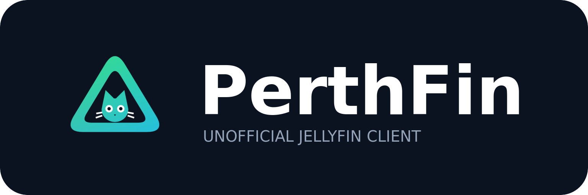

# PerthFin

PerthFin is an independent native Android client for [Jellyfin](https://jellyfin.org),
built on top of the open-source [Findroid](https://github.com/jarnedemeulemeester/findroid) project.

It is an independent derivative, **not a fork of the upstream repository**, and is
**not affiliated with, endorsed by, or sponsored by** the Jellyfin project or the
Findroid author. "Jellyfin" is used descriptively only.

## Upstream

PerthFin is a secondary development based on Findroid, originally created by
Jarne Demeulemeester and contributors:

- Upstream: https://github.com/jarnedemeulemeester/findroid
- Base: Findroid 1.2.0 (commit `3a06420`)
- License: GPLv3, see [LICENSE](LICENSE) and [NOTICE](NOTICE)

The upstream project is not responsible for this repository or its releases.

## Status

This branch is a rebrand and feature fork. The application id and branding are new, the download and offline features have been removed, and basic
server-side transcoding with a quality preset is available. DLNA is planned.

## Features

- Completely native Android interface (Kotlin, Jetpack Compose)
- Browse and play movies, series, seasons and episodes
- Direct play by default; server-side transcoding with 30/20/10/4/1.5 Mbps presets
- In-player quality switch (restarts the stream at the current position)
- ExoPlayer and mpv playback backends
- Picture-in-picture, chapters, trickplay, media segment skipping
- Multiple servers and users, Quick Connect login
- Android TV module (experimental, not released)

See the [Findroid README](https://github.com/jarnedemeulemeester/findroid#features) for the
inherited feature matrix and codec support.

## Requirements

- Jellyfin Server 12.0 or newer
- Android 10 (API 29) or newer

## Building

```bash
export JAVA_HOME=/path/to/jdk-17
export ANDROID_HOME=/path/to/android-sdk   # platform 37, build-tools 37.0.0
./gradlew :app:phone:assembleDebug
```

APKs are written to `app/phone/build/outputs/apk/libre/debug/`.

## License

GPLv3. See [LICENSE](LICENSE) and [NOTICE](NOTICE).

The original Findroid project is Copyright (C) Jarne Demeulemeester and contributors.
PerthFin modifications are Copyright (C) 2026 MeowPerth.
